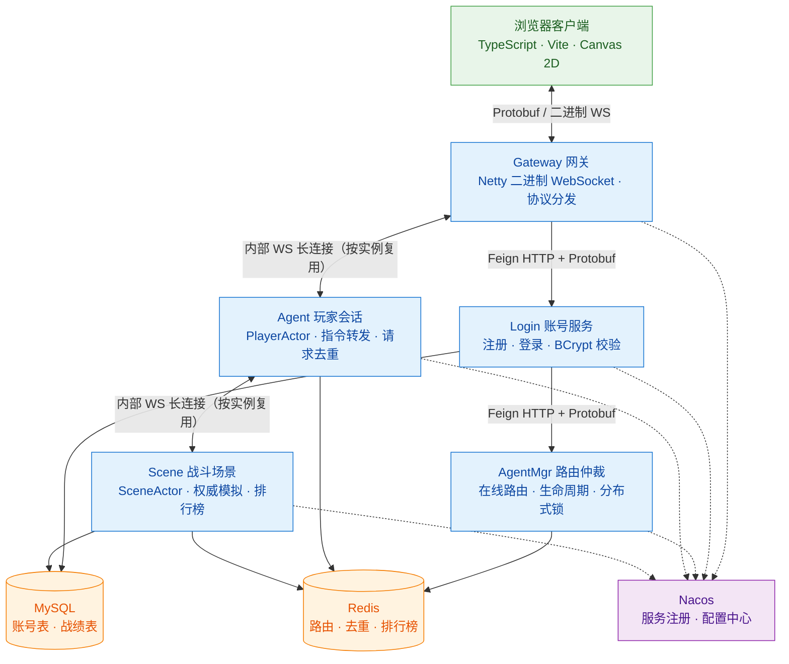
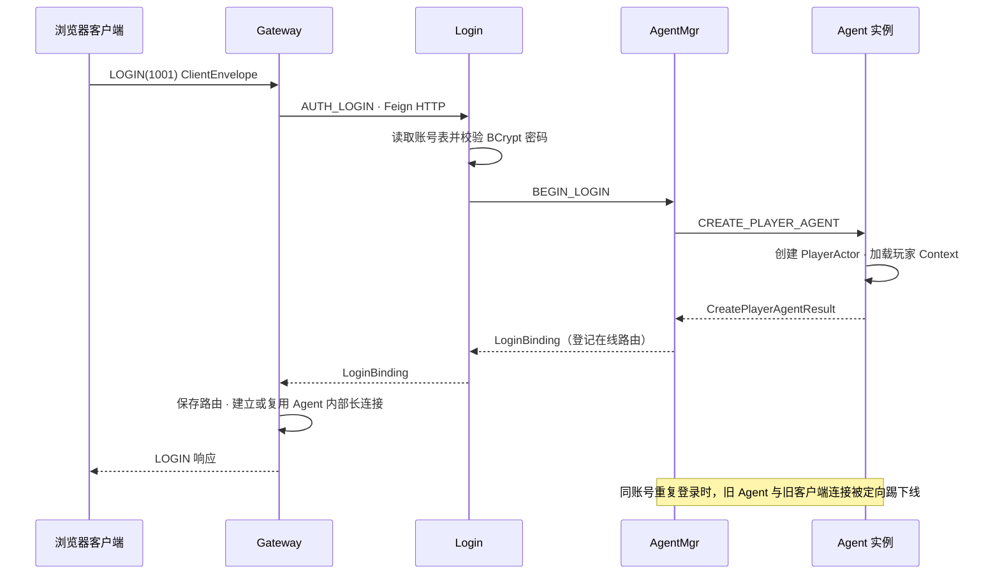
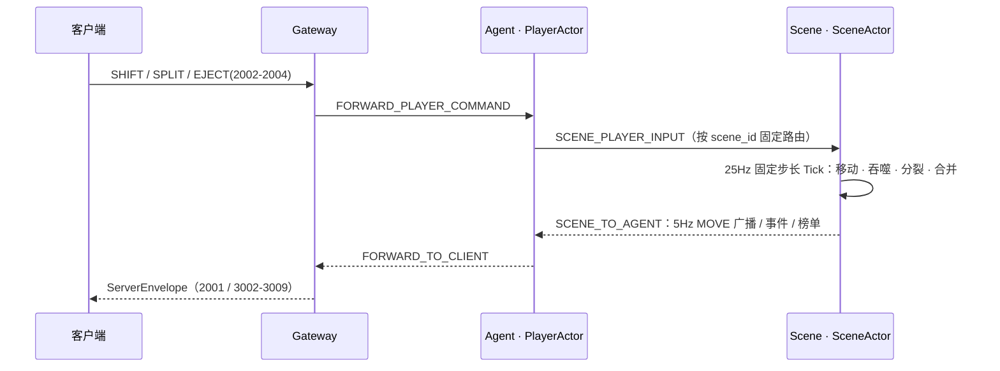

# BallsGame · 多人实时在线球球吞噬竞技游戏


> 从零开始，不使用任何现成游戏服务端框架，用 **Java 17** 打造的多人实时在线「球球吞噬」竞技游戏（Agar.io 类玩法）。
>
> 服务端由 5 个可独立部署的微服务组成，通过 **二进制 WebSocket + Protocol Buffers** 协议对外服务，以 **Akka Actor 模型** 承载服务端权威战斗模拟；客户端为 **TypeScript + Canvas** 的高性能 Web 实现，服务端逻辑 25Hz 固定步长推进，客户端按服务端 Tick 插值渲染。

---

## 目录

- [游戏玩法](#游戏玩法)
- [功能特性](#功能特性)
- [技术栈](#技术栈)
- [系统架构](#系统架构)
- [通信协议](#通信协议)
- [从 0 构建：自研核心组件](#从-0-构建自研核心组件)
- [快速开始](#快速开始)
- [测试](#测试)
- [仓库结构](#仓库结构)
- [文档索引](#文档索引)
- [已知边界](#已知边界)

---

## 游戏玩法

经典「球球吞噬」实时对战：

- **多人同场竞技**：所有玩家在同一张地图上实时对抗，地图尺寸、人数上限、对局时长均由服务端配置。
- **吞噬成长**：吞食地图上随机刷新的食物、吞噬比自己小的玩家球体，面积（质量）不断增长——体型越大越强，但也越笨拙。
- **操作方式**：鼠标指向移动（或 WASD / 方向键）；**空格**分裂、**E** 吐球；触屏设备按住拖动 + 按钮操作。
- **策略博弈**：分裂可以快速突进吞食猎物，但会分散质量、暴露破绽；吐球可以喂食队友或作为诱饵。
- **对局结算**：默认 10 分钟限时对局，实时面积排行榜 + 最终结算榜（含并列名次），战绩持久化后可随时查询。
- **观战与重开**：球被全部吞噬后可选择观战其他玩家，比赛结束后可立即开始下一局。

## 功能特性

| 维度 | 能力 |
| --- | --- |
| **账号体系** | 邮箱注册 / 登录；BCrypt 密码哈希存储；凭据不写日志；重复邮箱拦截；同账号重复登录自动踢掉旧会话 |
| **实时对战** | 服务端权威模拟（客户端只上报移动意图，无任何客户端判定的碰撞/得分）；移动、分裂、吐球、吞噬、合并完整规则 |
| **同步模型** | 服务端逻辑 25Hz 固定步长 Tick，位置 5Hz 广播；客户端基于服务端 Tick 的样本缓冲插值渲染，不做无权威依据的预测 |
| **对局系统** | 匹配 / 创建场景、等待室（达到最低人数才开赛计时）、限时对局、实时榜 / 最终榜、观战模式、离场重开 |
| **战绩持久化** | 整局完整排名 + 玩家个人战绩写入 MySQL（Protobuf 原始字节存储），按用户分页查询历史战绩 |
| **可靠投递** | requestId 端到端幂等（注册、登录、入场、离场、分裂、吐球全链路防重复）；失败重试复用原请求编号；迟到响应与上一轮登录的脏广播被识别拒绝 |
| **高并发底座** | Akka Actor 邮箱串行、无锁；Gateway↔Agent、Agent↔Scene 内部长连接按实例复用；Redis 分布式锁仲裁玩家生命周期 |
| **客户端工程** | TypeScript 严格模式 + Canvas 2D 渲染管线（球体光晕、粒子特效、小地图、HUD）；协议 schema 自动同步工具；离线回归测试 |

## 技术栈

| 层次 | 选型 |
| --- | --- |
| 语言 / 构建 | Java 17 · Maven 多模块 |
| 微服务框架 | Spring Boot 4.0 · Spring Cloud 2025.1 · Spring Cloud Alibaba（Nacos） |
| 接入层 | Spring Cloud Gateway（WebFlux）· **Netty**（二进制 WebSocket 服务） |
| 服务间通信 | OpenFeign（HTTP + Protobuf 载荷）· 自研 Netty 内部双向长连接 |
| 并发 / 模拟 | **Akka Classic Actor 2.6**（一局一 Actor，`AbstractActorWithTimers` 固定步长主循环） |
| 序列化协议 | Protocol Buffers 3（`proto3`，纯编解码，不依赖 gRPC 运行时） |
| 存储 | MySQL 8.4（MyBatis-Plus）· Redis 7.4（路由、去重、排行榜、分布式锁 / Redisson） |
| 注册与配置 | Nacos 2.5（服务发现 + 配置中心，战斗规则热更新） |
| 客户端 | TypeScript 5.9 · Vite 6 · Canvas 2D · protobufjs（64 位 ID 全程 BigInt 精度安全） |

## 系统架构



### 模块职责

| 模块 | 类型 | 职责 |
| --- | --- | --- |
| `game-protocol` | 协议库 | Protobuf 定义（客户端 / 服务间 / 持久化三套）与 Netty 编解码器、指令日志 |
| `game-common` | 公共库 | 客户端与服务端命令枚举、错误码、注解式命令注册表、有界 RPC 重试工具 |
| `game-core` | 基础库 | Akka 支持、内部 WebSocket 服务端 / 客户端、Peer 注册表 |
| `gateway-server` | 服务 | 客户端唯一入口：二进制 WS 接入、登录代理、指令分发、实例路由与内部长连接管理 |
| `login-server` | 服务 | 注册 / 登录 / 账号数据（MySQL），凭据校验后交棒 AgentMgr |
| `agentmgr-server` | 服务 | 登录生命周期仲裁：选定 Agent 实例、在线路由（Redis）、重复登录踢旧、断线清理 |
| `agent-server` | 服务 | 玩家会话层：PlayerActor 管理玩家上下文与请求去重，向 Scene 转发战斗指令 |
| `scene-server` | 服务 | 战斗权威：SceneActor 固定步长模拟（移动 / 吞噬 / 分裂 / 吐球）、榜单计算、战绩落库 |
| `nodemgr-server` | 服务 | 预留模块，当前未接入业务链路 |

### 登录链路（Gateway → Login → AgentMgr → Agent）



### 战斗数据流（客户端 → Gateway → Agent → Scene → 回程广播）



## 通信协议

全链路使用 Protobuf `proto3` 二进制编码，两种「信封 + 命令号」结构，客户端与服务间互不暴露内部模型：

**客户端通道（Gateway 对外）**

```text
ClientEnvelope  { cmd, request_id, body, client_sequence }   ← 客户端请求
ServerEnvelope  { cmd, request_id, code, message, body }     ← 响应 & 主动推送（request_id=0）
```

**服务间通道（Feign HTTP / 内部 WS 共用）**

```text
ServiceEnvelope { oneof: request | response | event }
```

### 客户端命令

| cmd | 名称 | 方向 | 说明 |
| --- | --- | --- | --- |
| 1001 | `LOGIN` | C → S | 登录（经 Login 全链路） |
| 1002 | `REGISTER` | C → S | 邮箱注册（不自动登录） |
| 1003 | `MATCH_HISTORY` | C → S | 查询本人历史战绩 |
| 2001 | `MOVE` | S → C | 位置广播 `MoveBroadcast`（非请求） |
| 2002 | `SPLIT` | C → S | 分裂 |
| 2003 | `EJECT` | C → S | 吐球 |
| 2004 | `SHIFT` | C → S | 移动意图（服务端计算实际位移） |
| 2005 | `LEAVE` | C → S | 主动离开比赛（保留登录态） |
| 2006 | `START_GAME` | C → S | 开始对局（匹配 / 创建场景） |
| 3001 | `KICKED_OFFLINE` | S → C | 被异地登录踢下线通知 |
| 3002-3007 | `SCENE_SNAPSHOT` / `PLAYER_ENTERED` / `FOOD_ADDED` / `FOOD_EATEN` / `PLAYER_LEFT` / `BALL_CHANGED` | S → C | 场景快照与增量事件 |
| 3008 | `MATCH_RANKING` | S → C | 实时排行榜 |
| 3009 | `MATCH_ENDED` | S → C | 最终榜（frozen） |

### 服务间命令（节选）

`AUTH_LOGIN` → `BEGIN_LOGIN` → `CREATE_PLAYER_AGENT`（登录链路）；`AGENT_LINK_HELLO` / `FORWARD_PLAYER_COMMAND` / `FORWARD_TO_CLIENT`（Gateway↔Agent 通道）；`AGENT_SCENE_LINK_HELLO` / `SCENE_JOIN` / `SCENE_LEAVE` / `SCENE_PLAYER_INPUT` / `SCENE_TO_AGENT`（Agent↔Scene 通道）；`KICK_OLD_AGENT` / `KICK_OLD_CLIENT` / `PLAYER_DISCONNECTED`（生命周期仲裁）。

## 从 0 构建：自研核心组件

本项目的定位是**从零实现**一套完整的实时对战游戏服务端，除通用框架（Spring / Netty / Akka / Protobuf 运行时）外，以下核心机制均为自研实现：

1. **二进制游戏协议栈** — 自定义「信封 + 命令号 + Protobuf body」双层协议，客户端与服务间两套信封互不泄漏内部模型；Netty 编解码器、未知命令容错、带 requestId 的协议错误响应全部手写。
2. **注解式命令分发框架** — `@GameCommand` / `@ServiceCommand` / `@GatewayCommand` 注解 + 注册表扫描，启动时校验命令冲突，运行期按 cmd 查表分发，五个服务共用同一套底座。
3. **服务间长连接通道** — 自研 `InternalWebSocketServer` / `SharedWebSocketClient`（基于 Netty）：Gateway↔Agent、Agent↔Scene 按实例对复用单条双向连接，握手校验实例身份，广播按实例分组打包；心跳与断开由链路层统一处理。
4. **固定步长游戏主循环** — 基于 Akka `startSingleTimer` + `System.nanoTime` 累积，`1 / tick-rate` 固定 dt 推进（参考 [Fix Your Timestep](https://gafferongames.com/post/fix_your_timestep/)）；补帧次数有上限、超额积压丢弃告警，逻辑 Tick 只随真实执行递增。
5. **端到端幂等与防重放** — `requestId` 从客户端贯穿 Gateway / Login / AgentMgr / Agent / Scene 五层；`login_operation_id` 绑定端到端期限、`joinOperationId` 隔离每轮入场、`playerActorId` 拒绝上一轮登录的迟到广播；SPLIT / EJECT 保留最近 1024 个最终响应原样重放（Redis 去重窗口），SHIFT 以递增 `client_sequence` 丢弃过期方向输入。
6. **服务端权威 + 空间索引** — 移动、吞噬、分裂、合并全部在 SceneActor 邮箱内串行计算；食物判定走空间网格筛选，杜绝客户端参与任何物理与得分计算。
7. **客户端渲染与协议同步** — `sync-protocol.mjs` 只读后端 `.proto` 自动生成前端 schema；64 位 ID 全程按 BigInt 处理；渲染管线带样本缓冲插值（约 220ms 缓冲），无权威样本时保持最后位置、不做无限预测。

## 快速开始

### 1. 启动基础设施（MySQL / Redis / Nacos）

```bash
docker compose up -d
# MySQL   : localhost:3307  (database: ballsgame)
# Redis   : localhost:6379
# Nacos   : http://localhost:8848/nacos
```

初始化数据库（账号表 + 战绩表，统一建表脚本）：

```bash
mysql -h127.0.0.1 -P3307 -uroot -p ballsgame < backend/agent-server/src/main/resources/db/schema.sql
```

在 Nacos 中创建 `global-prod.yaml`（DEFAULT_GROUP），填入 MySQL / Redis 连接与 `battle.*` 战斗规则。战斗规则示例见 [`backend/config/nacos-global-battle.yaml`](backend/config/) 与 [`backend/config/README.md`](backend/config/README.md)。

> 生产环境请务必修改 docker-compose 中的默认口令，并对内部端口（Agent WS / Scene WS / 各服务 HTTP）做网络隔离。

### 2. 编译并启动后端（Java 17+）

```bash
cd backend
mvn clean package -DskipTests

# 启动顺序建议：Gateway → Login → AgentMgr → Agent → Scene
java -jar gateway-server/target/gateway-server-*.jar
java -jar login-server/target/login-server-*.jar
java -jar agentmgr-server/target/agentmgr-server-*.jar
java -jar agent-server/target/agent-server-*.jar
java -jar scene-server/target/scene-server-*.jar
```

各服务从 Nacos 读取配置并注册；Gateway 默认以二进制 WebSocket 对外提供 `/ws` 接入（端口以 Nacos 配置为准，示例为 `9001`）。

### 3. 启动 Web 客户端

```bash
cd frontend
npm install
npm run dev
```

浏览器打开 `http://127.0.0.1:5173`，即可注册账号并开始对局。网关地址在 `frontend/public/client-config.js` 中配置：

```javascript
window.BALLS_CLIENT_CONFIG = { gatewayUrl: 'ws://127.0.0.1:9001/ws' };
```

## 测试

后端（真实 Akka、MyBatis-Plus/H2、离线 Redis 替身；覆盖 Actor 生命周期、指令分发、请求去重、结算与路由校验）：

```bash
cd backend
mvn -pl gateway-server,login-server,agentmgr-server,agent-server,scene-server -am clean test
```

可选的「真实基础设施」检查（需要 Nacos / MySQL / Redis 就绪，只读校验、不写业务数据）：

```bash
mvn -pl gateway-server,login-server,agentmgr-server,agent-server,scene-server -am clean test -Dballs.infrastructure-test=true
```

前端（离线回归：原包重试、临时错误、迟到响应、跨连接隔离、离场恢复、插值与权威状态分离）：

```bash
cd frontend
npm test              # Node test runner 离线回归
npm run protocol:check   # 校验前端 schema 与后端 proto 一致性
npm run build         # 类型检查 + 生产构建
```

## 仓库结构

```text
BallsGame/
├── backend/                          # Java 服务端（Maven 多模块）
│   ├── game-protocol/                #   Protobuf 协议定义与编解码
│   ├── game-common/                  #   命令枚举、错误码、注解注册表等公共设施
│   ├── game-core/                    #   Akka / Netty 基础库
│   ├── gateway-server/               #   接入网关（二进制 WS、协议分发）
│   ├── login-server/                 #   账号服务（注册 / 登录 / MySQL）
│   ├── agentmgr-server/              #   登录生命周期与在线路由仲裁
│   ├── agent-server/                 #   玩家会话 Actor 层
│   ├── scene-server/                 #   战斗场景权威模拟
│   ├── nodemgr-server/               #   预留模块（未接入链路）
│   ├── config/                       #   Nacos 配置说明与战斗规则示例
│   └── docker-compose.yml            #   MySQL / Redis / Nacos 本地环境
└── frontend/                         # TypeScript Web 客户端
    ├── src/network/gateway.ts        #   WebSocket 连接、请求匹配、超时重试
    ├── src/game/                     #   权威快照、渲染器、输入、消息处理
    ├── src/protocol/                 #   协议生成物与编解码
    ├── scripts/sync-protocol.mjs     #   后端 proto → 前端 schema 同步工具
    └── tests/                        #   离线回归测试与浏览器冒烟页
```

## 文档索引

| 文档 | 内容 |
| --- | --- |
| [`frontend/README.md`](frontend/README.md) | 客户端功能、操作说明、连接配置与可靠性细节 |
| [`frontend/UI_DESIGN.md`](frontend/UI_DESIGN.md) | 界面视觉与渲染设计说明 |
| [`backend/gateway-server/README-protocol.md`](backend/gateway-server/README-protocol.md) | 网关协议、登录链路与内部长连接约定 |
| [`backend/scene-server/README.md`](backend/scene-server/README.md) | 战斗规则、固定步长主循环、幂等与排名存储设计 |
| [`backend/config/README.md`](backend/config/README.md) | Nacos 配置结构、启动检查与指令日志说明 |

## 已知边界

本项目为**从零实践**性质的完整实现，以下边界如实声明：

- 战斗状态为内存态：未实现 Scene 进程崩溃后的对局恢复、战斗回放与跨实例迁移；
- 未实现奖励发放、好友、背包、房间列表等外围系统；
- 对局内球体碰撞当前为硬上限下的两两检查，尚未做全量空间索引优化；
- 默认口令与端口仅适用于本地开发，生产部署需要自行加固。
