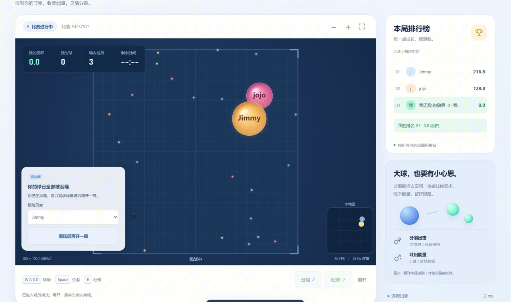

# BallsGame 实机演示

[返回项目说明](../README.md)

本视频为项目实机录制，展示当前游戏的实际运行情况。

[在 GitHub 打开视频](https://github.com/Hhhhh-002/BallsGame/blob/main/docs/media/gameplay.mp4) · [下载演示视频（MP4）](https://github.com/Hhhhh-002/BallsGame/raw/refs/heads/main/docs/media/gameplay.mp4)

如果浏览器未直接播放，可下载后使用本地播放器观看。

## 项目说明

本项目是本人在学习过程中从零独立开发的多人实时在线游戏，主要聚焦 Java 游戏服务端架构与核心游戏逻辑的设计和实现。Web 客户端在 AI 辅助下开发，用于联调与玩法展示。项目仍有不少不足，后续将持续完善功能、优化性能，并改进工程质量。欢迎交流与指正。

源录像：`10月24日.mp4`。仓库中的 MP4 为压缩展示版，未裁剪录制内容；原始录像保留在本地。
